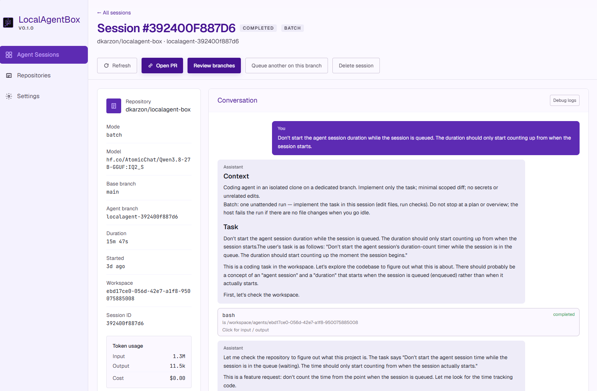

# Local Agent Box

A self-hosted daemon for running autonomous coding agents (powered by [OpenCode](https://opencode.ai)) against your own GitHub repositories and your own LLM (local via Ollama, or any OpenCode-compatible provider).
> Spin up, check out, push code - entirely on infrastructure you control.

## What this is (and isn't)

- **Is:** a small API + UI you self-host (Docker or bare Node) that clones a repo, runs an OpenCode agent against a prompt, and commits/pushes the result — with batch and review modes (interactive and loop modes were removed in v1).
- **Is:** designed for a **trusted local network** (home LAN, VPN, single-tenant internal network) — see [SECURITY.md](./SECURITY.md) before exposing it more broadly.
- **Isn't:** a multi-tenant SaaS, a sandboxed execution environment, or a hardened public-internet service out of the box. Agents run with full filesystem access to their workspace and no network isolation.
- **Isn't:** affiliated with, or a redistribution of, any third-party hosted "cloud agent" product — it's an independent, self-hosted alternative built on OpenCode.



## Architecture

```
   HTTP API + UI (Node/Express, React)
            │
            ▼
     Agent scheduler (main process)
            │  spawns one child process per running agent
            ▼
   Worker (opencode serve + harness)  ──git──▶  GitHub (via GitHub App)
            │
            ▼
   Ephemeral workspace clone (AGENT_WORKSPACE)
```

- A single Node process serves the REST/SSE API and the built UI, and persists state (`config.json`, `repos.json`, `agents.json`) as JSON files under `DATA_DIR`.
- Each agent run is a separate child process (`src/workers/agent-worker.ts`) that shallow-clones the target repo into its own workspace and drives one of two flows: **batch** (a per-agent `opencode serve` instance, single prompt → commit/push) or **review** (branch-range PR review via [Open Code Review](https://alibaba.github.io/open-code-review/#/docs) → optional GitHub PR comments). Follow-up work on a branch is a new batch run, not a continuation of the previous one.
- GitHub access goes through a **GitHub App** installation token minted per-request (`src/services/github-app.ts`) — no long-lived PAT or SSH key is stored.
- Agent state, logs, and events stream back to the API over the child process's stdout/IPC and are exposed to the UI via Server-Sent Events.

There is no per-agent sandboxing (container, chroot, network namespace) — see [SECURITY.md](./SECURITY.md) for what that means for your deployment.

## Quick start

### Prebuilt image (recommended)

Pull the published image from GitHub Container Registry:

```bash
docker pull ghcr.io/dkarzon/localagent-box:latest
```

Full run instructions, Compose example, and **required environment variables** (`API_TOKEN`, `NODE_ENV`, `OLLAMA_BASE_URL`, volumes): [docs/docker-hosting.md](./docs/docker-hosting.md).

Minimal example:

```bash
docker volume create localagent-data
docker volume create localagent-workspace
docker run -d --name localagent-box --restart unless-stopped -p 8080:8080 \
  -e NODE_ENV=production -e API_TOKEN=your-secret-token \
  -e OLLAMA_BASE_URL=http://host.docker.internal:11434 \
  --add-host=host.docker.internal:host-gateway \
  -v localagent-data:/data -v localagent-workspace:/workspace \
  ghcr.io/dkarzon/localagent-box:latest
```

### Build from source

```bash
docker compose up -d --build
```

Open the management UI at [http://localhost:8080](http://localhost:8080). The default API token is `localagent-box` (pre-filled in the UI) — this is fine for a quick local trial, but **set a strong `API_TOKEN`** (and read [SECURITY.md](./SECURITY.md)) before running this anywhere reachable by anyone you don't trust.

Next steps: [set up a GitHub App](./docs/github-app-setup.md) so agents can clone, commit, and open PRs against your repos.

## Local development

The repo has two parts: a **TypeScript Node.js API** in `src/` (compiled to `dist/`) and a **React + Vite UI** in `client/`. In production and Docker, the API serves the built UI from `public/`.

### Prerequisites

- **Node.js** ≥ 20
- **Git** (clone/verify/push)
- **Ollama** — optional for health checks; required to run agents against a local model
- **OpenCode CLI (v2)** — `npm install -g @opencode/cli@2.2.7` (matches the version pinned in the Dockerfile; needed when starting agent jobs locally). Uninstall v1 first (`npm uninstall -g opencode-ai`) — both install an `opencode` binary.

### Install dependencies

From the repo root:

```bash
npm install --ignore-scripts
npm install --prefix client
```

Use `--ignore-scripts` on the root install if the `postinstall` hook loops on your machine; then install the client explicitly as shown.

### Run locally

Build the UI and API, then serve everything from one process:

```bash
# Windows (PowerShell)
$env:DATA_DIR="./data"; npm run build:ui && npm run build && npm start

# macOS / Linux
DATA_DIR=./data npm run build:ui && npm run build && npm start
```

Open [http://localhost:8080](http://localhost:8080).

Persisted state (config, repos, agents) is written under `./data/` when `DATA_DIR=./data` is set. Agent git workspaces use `./data/workspace/agents/` on Windows.

For API-only work with auto-restart on change, use `npm run dev` instead of `npm start` (after building the UI once).

### Local Docker build and run

To use the **prebuilt GHCR image** instead of building locally, see [docs/docker-hosting.md](./docs/docker-hosting.md).

Run once to create the volumes (shared across docker sessions):
```bash
docker build --tag 'localagent-box' .
```

Build and run the docker image.

```bash
docker volume create localagent-data
docker run -it --rm -p 8080:8080 -v localagent-data:/data 'localagent-box'
```

### Useful local environment variables

| Variable | Default (local) | Purpose |
|----------|-----------------|---------|
| `PORT` | `8080` | HTTP listen port |
| `DATA_DIR` | `/data` | Config and agent state directory (use `./data` locally) |
| `API_TOKEN` | `localagent-box` | Bearer token for mutating API calls |
| `OLLAMA_BASE_URL` | — | Bootstrap local Ollama URL on first start (e.g. `http://localhost:11434`) |
| `OLLAMA_CLOUD_API_KEY` | — | Bootstrap Ollama Cloud API key on first start |
| `OLLAMA_CLOUD_BASE_URL` | — | Optional Cloud host (default `https://ollama.com`) |
| `OPENAI_COMPATIBLE_BASE_URL` | — | Bootstrap an OpenAI-compatible server (Strata, LM Studio, vLLM, llama.cpp) on first start |
| `OPENAI_COMPATIBLE_API_KEY` | — | Optional API key for the OpenAI-compatible server |
| `AGENT_WORKSPACE` | platform-specific | Directory for ephemeral agent clones |
| `MAX_CONCURRENT_AGENTS` | `3` | Concurrent agent workers |
| `AGENT_TIMEOUT` | `3600` | Batch worker timeout in seconds, measured from when the worker starts running (not queue wait) |
| `OCR_REVIEW_TIMEOUT` | `30` | Per-file OCR review deadline in minutes (`0` disables). OCR's own default is 10. |
| `OCR_LLM_TIMEOUT` | `600` | Per-request OCR LLM HTTP timeout in seconds. OCR's own default is 300. |
| `OCR_REVIEW_CONCURRENCY` | `8` | Max file groups reviewed in parallel. Lower for local LLMs (e.g. Ollama). |
| `OPENCODE_BIN` | `opencode` | OpenCode CLI binary (must be the executable, not its folder). On Windows a bare `opencode` is resolved to the real `opencode.exe` behind npm's `.cmd` shim, so it usually needs no setting |
| `OPENCODE_PORT_BASE` | `4100` | Base port for per-agent `opencode serve` |
| `OPENCODE_STARTUP_TIMEOUT_MS` | `900000` | Max wait for `opencode serve` to become ready |

### Scripts reference

| Command | Description |
|---------|-------------|
| `npm run dev` | Run API from TypeScript with `tsx watch` |
| `npm run dev:ui` | Vite dev server for the React UI |
| `npm run build` | Compile `src/` → `dist/` |
| `npm run build:ui` | Build UI into `public/` |
| `npm start` | Run compiled API (`dist/server.js`) |
| `npm run smoke` | Smoke-test the OpenCode harness end to end (see below) |
| `npm run smoke:docker` | Build the image and run the smoke test inside a container |

### Harness smoke test

Runs one real OpenCode turn through the same path agent runs use: generated `opencode.json` → `opencode serve` → authenticated readiness → event stream → session → a prompt that must write `SMOKE.txt` with a tool call. Each stage prints ✔ / ✖ / ! (warning). It uses the provider and model from Settings (`DATA_DIR/config.json`), plus any `OLLAMA_*` / `OPENAI_COMPATIBLE_*` / `OPENCODE_MODEL` / `OPENCODE_PROVIDER` values from the environment or `.env` that the server would seed on startup (applied in memory, never saved). It runs in a throwaway workspace and never touches agents, repos or GitHub. If no model is set anywhere, pass `--model`.

```bash
npm run smoke                                   # local, from source
npm run smoke -- --model qwen3-coder:30b        # override the Settings model
npm run smoke -- --server-only                  # no model call: config, server, auth, events, session
docker exec localagent-box node /app/dist/entrypoints/smoke.js   # inside the container
```

To test what ships, `npm run smoke:docker` builds the image from your checkout (tagged `localagent-box:smoke`, so a running `localagent-box` container is untouched) and runs the smoke test in a throwaway container. Provider settings (`OPENCODE_*`, `OLLAMA_*`, `OPENAI_COMPATIBLE_*`) are passed in from your shell or `.env` by name, so secrets stay off the command line. It warns if a provider URL uses `localhost`, which inside the container means the container itself (use `host.docker.internal` or a LAN address).

```bash
npm run smoke:docker -- --model qwen3-coder:30b            # build + run (smoke options are forwarded)
npm run smoke:docker -- --no-build --data agent-data       # reuse the image; read Settings from the compose volume
npm run smoke:docker -- --container localagent-box         # run inside an existing container, with its Settings
```

Options: `--provider <id>`, `--timeout <sec>` (default 300), `--codegraph`, `--keep` (keep the temp workspace), `--json`. Exit code `0` = passed (warnings allowed), `1` = a check failed, `2` = bad usage. On failure the temp workspace and a `debug.log` are kept and their path is printed.

## GitHub App setup

Agents authenticate to GitHub as an installed **GitHub App** (no PAT or SSH key). See [docs/github-app-setup.md](./docs/github-app-setup.md) for step-by-step instructions: creating the app, scoping permissions (Contents + Pull requests + Checks, read/write), installing it on your repos, generating a private key, and wiring the resulting `githubAppId` / `githubAppInstallationId` / `githubAppPrivateKey` into Settings.

## Security

localagent-box is built for a **trusted local network**, not the open internet. Highlights (full detail in [SECURITY.md](./SECURITY.md)):

- Mutating endpoints require a Bearer token; most `GET` endpoints (config, agent logs/transcripts/events, repo metadata) are **intentionally unauthenticated** so the UI and SSE streams work without embedding a token in every request.
- The default `API_TOKEN` (`localagent-box`) is meant for local trials only — always override it before exposing the service beyond your own machine, and set `NODE_ENV=production` so the server refuses to boot with the default token.
- Agents run as plain child processes with full access to their workspace and the host's network — there is no per-agent sandbox.
- If you must reach this from outside a trusted LAN/VPN, put it behind a reverse proxy with its own TLS + auth; never port-forward it directly.

Read [SECURITY.md](./SECURITY.md) before deploying anywhere beyond a local trial.

## Troubleshooting

| Symptom | Likely cause / fix |
|---------|---------------------|
| `401 Unauthorized` on `POST`/`PUT`/`DELETE` calls | Missing or wrong `Authorization: Bearer <API_TOKEN>` header; check the token in Settings or your `API_TOKEN` env var |
| Server refuses to start in Docker/production | `NODE_ENV=production` with the default `API_TOKEN` (`localagent-box`) still set — pick a real token |
| Health check shows Ollama as unreachable | `ollamaBaseUrl` isn't reachable from inside the container — on Docker Desktop use `http://host.docker.internal:11434`, not `localhost` |
| Agent fails immediately with a GitHub/clone error | GitHub App isn't installed on that repo, or `githubAppId`/`githubAppInstallationId`/`githubAppPrivateKey` are wrong — see [docs/github-app-setup.md](./docs/github-app-setup.md#troubleshooting) |
| Agent finishes but no PR appears | `push` was `false`, or the OpenCode run didn't produce a commit — batch runs fail if nothing was committed; check `GET /agents/:id/logs` |
| Review agent fails immediately | OCR review provider not configured or unreachable — check **Settings → Models** and **Settings → OCR**; see [docs/code-review.md](./docs/code-review.md) |
| Review completes but nothing on GitHub | No PR exists for `headBranch`, or GitHub App lacks pull request write — check logs for "No matching PR" or GitHub warnings |
| The `localagent-box / review` check is missing on PRs | The installation hasn't accepted the **Checks: Read and write** permission — update the app's permissions and re-approve the installation (GitHub notifies the owner); reviews still complete without it |
| The `localagent-box / review` check is stuck `in_progress` | The server was restarted mid-review — startup reconciliation cancels interrupted reviews' checks; if one remains, retry the review (a new check run replaces it) |
| Agents fail early or hang and you're not sure if it's the model or the harness | Run the [harness smoke test](#harness-smoke-test); the first ✖ shows which stage broke, with the provider's own error message |
| `npm install` hangs or loops | Use `npm install --ignore-scripts` at the repo root, then `npm install --prefix client` separately (see [Install dependencies](#install-dependencies)) |

For anything else, check `GET /agents/:id/logs` and `GET /agents/:id/events` for the failing session, and [SECURITY.md](./SECURITY.md) if the question is auth/network-related.

## API v1

Base URL: `http://localhost:8080`

Mutating requests require `Authorization: Bearer <API_TOKEN>`. Default token: `localagent-box`.

| Method | Path | Auth | Description |
|--------|------|------|-------------|
| `GET` | `/health` | No | Liveness check + Ollama connectivity probe |
| `GET` | `/api/v1/config` | No | Current settings (secrets redacted) |
| `PUT` | `/api/v1/config` | Yes | Update settings and write OpenCode config |
| `GET` | `/api/v1/github/status` | No | GitHub App credential summary (no secrets) |
| `POST` | `/api/v1/github/verify` | Yes | Test shallow clone of `{ owner, name, branch? }` |
| `GET` | `/api/v1/repos` | No | List registered repos |
| `POST` | `/api/v1/repos` | Yes | Register repo `{ owner, name, defaultBranch }` |
| `GET` | `/api/v1/repos/:repoId` | No | Get registered repo metadata |
| `DELETE` | `/api/v1/repos/:repoId` | Yes | Remove registered repo |
| `PUT` | `/api/v1/repos/:repoId` | Yes | Update repo settings (`autoReviewPullRequests`: `true`, `false`, or `null` to inherit) |
| `POST` | `/api/v1/repos/:repoId/verify` | Yes | Test shallow clone for registered repo |
| `GET` | `/api/v1/agents` | No | List agents (`?repoId=`, `?status=` filters) |
| `POST` | `/api/v1/agents` | Yes | Start repo-scoped agent |
| `GET` | `/api/v1/agents/:agentId` | No | Agent status |
| `GET` | `/api/v1/agents/:agentId/logs` | No | Agent log tail (`?tail=200`, default 200) |
| `GET` | `/api/v1/agents/:agentId/events` | No | SSE stream of agent events (`?since=` or `Last-Event-ID`) |
| `GET` | `/api/v1/agents/:agentId/messages` | No | Transcript + events snapshot (`?since=` for event replay) |
| `POST` | `/api/v1/agents/:agentId/retry` | Yes | Re-queue a failed or cancelled session in the same slot |
| `POST` | `/api/v1/agents/:agentId/allow-successors` | Yes | Let later sessions on the same branch start after a failed/cancelled chunk |
| `POST` | `/api/v1/agents/:agentId/pull-request` | Yes | Open GitHub PR for completed, pushed session |
| `GET` | `/api/v1/agents/:agentId/pull-request` | No | Refresh linked PR state from GitHub |
| `POST` | `/api/v1/agents/:agentId/delete` | Yes | Remove agent record, logs, and workspace |
| `DELETE` | `/api/v1/agents/:agentId` | Yes | Cancel a running or queued agent |

### Config fields

| Field | Description |
|-------|-------------|
| `ollamaBaseUrl` | External self-hosted Ollama URL |
| `ollamaCloudApiKey` | Ollama Cloud API key (secret; redacted in GET) |
| `ollamaCloudBaseUrl` | Optional Cloud host (default `https://ollama.com`) |
| `opencodeModel` | Default model on the OpenCode provider |
| `opencodeProvider` | OpenCode provider id (`ollama` or `ollama-cloud`) |
| `reviewProvider` | OCR provider id; empty inherits `opencodeProvider` |
| `systemPrompt` | Default system prompt for agents (empty string stored as `null` in GET) |
| `githubAppId` | GitHub App ID |
| `githubAppInstallationId` | Installation ID |
| `githubAppPrivateKey` | PEM private key *(sent as `***` in GET; omit or send `***` on PUT to keep existing key)* |
| `gitUserName` | Commit author name |
| `gitUserEmail` | Commit author email |
| `webhookUrl` | Optional HTTP(S) URL; POST JSON on terminal agent status (`agent.completed`, `agent.failed`, `agent.cancelled`). Global default; per-repo override on the Repositories page wins for that repo's agents |
| `batchAutoApprovePermissions` | When true (default), batch agents auto-approve OpenCode tool permissions via per-agent `opencode.json` |
| `autoCreatePullRequest` | When true (default), automatically open a draft PR once an agent completes and pushes its branch. A per-agent `autoCreatePullRequest` on create overrides this. |
| `autoReviewPullRequests` | When true, auto-queue a review agent after a coding agent's PR is created (default false). Per-repo `autoReviewPullRequests` overrides this global default. See [docs/code-review.md](./docs/code-review.md). |
| `reviewModel` | Model used for auto-queued and manual review agents (Open Code Review); falls back to `opencodeModel` when empty |

All fields above are readable via `GET /api/v1/config` and settable via `PUT /api/v1/config`. The **Settings** UI is split into bookmarkable sections: **General**, **Models**, **GitHub**, **OpenCode**, and **OCR** — each page saves only its own fields. Batch agents run through `opencode serve` with per-agent isolated config at `{dataDir}/agents/{agentId}/opencode-config/opencode.json`; review agents run the Open Code Review CLI against the provider settings from **Settings → OCR**. Per-agent `autoApprovePermissions` on create overrides the batch default from Settings.

Config keys belonging to modes removed in v1 (`interactiveAutoApprovePermissions`, `interactiveAgentTimeoutSeconds`, `loopAutoApprovePermissions`, `loopAgentTimeoutSeconds`, `loopVerbModels`, `loopDefaultMaxIterations`) are no longer part of `AppConfig`: a `config.json` that still holds them is loaded with a warning (`ignoring unknown config keys`) and saved without them, and any other key unknown to the server is dropped the same way.

#### Model resolution

For a batch run the model is chosen in this order:

1. **`model` on agent create** — per-agent override from the create form
2. **`opencodeModel`** — global default from Settings
3. **OpenCode default** — when nothing above is set

For a review run: `model` on create → `reviewModel` → `opencodeModel` → OpenCode default. The generated `opencode.json` registers the Settings default plus the run's own model.

#### Per-model token costs (`modelTokenCosts`)

Ollama reports no cost amounts, so each session's cost is computed from its token usage using the per-model rates in `modelTokenCosts` — USD per 1,000,000 tokens per category (`input`, `output`, `cacheRead`, `cacheWrite`; reasoning tokens are billed at the `output` rate). Keys are model ids (`llama3.2` or `ollama/llama3.2`). Models without an entry cost $0 — there is no wildcard fallback. A non-zero cost reported by the provider always wins. Rates must be non-negative numbers; anything else is dropped on save. Costs computed from these rates are shown as "(est.)" in the UI. Edit via **Settings → Models → Token costs** or `PUT /api/v1/config`:

```json
{
  "modelTokenCosts": {
    "llama3.2": { "input": 0.1, "output": 0.3, "cacheRead": 0.05, "cacheWrite": 0.1 },
    "qwen3-coder:30b": { "input": 0.2, "output": 0.6 }
  }
}
```

The same rates are written into the generated `opencode.json` model entries (`cost`), so OpenCode's own cost figures match.

### Examples

```bash
curl http://localhost:8080/health

curl http://localhost:8080/api/v1/config

curl -X PUT http://localhost:8080/api/v1/config \
  -H "Authorization: Bearer localagent-box" \
  -H "Content-Type: application/json" \
  -d '{"ollamaBaseUrl":"http://host.docker.internal:11434","opencodeModel":"llama3.2"}'
```

Saving OpenCode settings writes `opencode.json` to `~/.config/opencode/` when the selected OpenCode provider is configured. `GET /health` returns `providers.ollama` and `providers['ollama-cloud']` (top-level `ollama` remains for backward compatibility).

Optional bootstrap env vars: `OLLAMA_BASE_URL`, `OLLAMA_CLOUD_API_KEY`, `OLLAMA_CLOUD_BASE_URL`, `OPENAI_COMPATIBLE_BASE_URL`, `OPENAI_COMPATIBLE_API_KEY`, `OPENCODE_MODEL`, `OPENCODE_PROVIDER`.

### GitHub App verify

```bash
curl http://localhost:8080/api/v1/github/status

curl -X POST http://localhost:8080/api/v1/github/verify \
  -H "Authorization: Bearer localagent-box" \
  -H "Content-Type: application/json" \
  -d '{"owner":"your-org","name":"your-private-repo","branch":"main"}'
```

Installation tokens are minted server-side and never returned by the API. Clone URLs with embedded tokens are redacted from error messages.

### Repo registration

```bash
curl http://localhost:8080/api/v1/repos

curl -X POST http://localhost:8080/api/v1/repos \
  -H "Authorization: Bearer localagent-box" \
  -H "Content-Type: application/json" \
  -d '{"owner":"your-org","name":"your-repo","defaultBranch":"main"}'

curl -X POST http://localhost:8080/api/v1/repos/your-org-your-repo/verify \
  -H "Authorization: Bearer localagent-box" \
  -H "Content-Type: application/json" \
  -d '{}'
```

Repo metadata is persisted in `DATA_DIR/repos.json`. Clones happen in ephemeral workspaces at verify/agent time, not at registration.

### Agents

Agents support two modes:

| Mode | Behavior |
|------|----------|
| **`batch`** (default) | Single prompt → `opencode serve` (session orchestrator) → auto commit/push → terminal status. Best for API, CI, and one-shot UI runs. |
| **`review`** | Branch-range PR review via [Open Code Review](https://alibaba.github.io/open-code-review/#/docs) (`ocr review`). Clones and checks out `headBranch`, diffs against `baseBranch`, posts findings to GitHub when a matching PR exists. No OpenCode session; no commit/push. See [docs/code-review.md](./docs/code-review.md). |

Omit `mode` or set `"mode": "batch"` for the headless behavior. A run is one turn: follow-up work is a **new batch run on the same branch**, created with `useExistingBranch: true` and `baseBranch` set to the branch the previous run pushed. The modes removed in v1 (`interactive`, `loop`) are rejected on create, and pre-v1 records that carry them are displayed read-only.

```bash
curl http://localhost:8080/api/v1/agents
curl "http://localhost:8080/api/v1/agents?repoId=your-org-your-repo&status=running"

# Batch (default)
curl -X POST http://localhost:8080/api/v1/agents \
  -H "Authorization: Bearer localagent-box" \
  -H "Content-Type: application/json" \
  -d '{
    "repoId": "your-org-your-repo",
    "prompt": "Add input validation to the login form",
    "systemPrompt": "You are a careful code reviewer.",
    "baseBranch": "main",
    "agentBranch": "agent/task-42",
    "commitMessage": "Agent: add login validation",
    "push": true,
    "model": "llama3.2"
  }'

# Follow-up batch run on the branch the run above pushed
curl -X POST http://localhost:8080/api/v1/agents \
  -H "Authorization: Bearer localagent-box" \
  -H "Content-Type: application/json" \
  -d '{
    "repoId": "your-org-your-repo",
    "prompt": "Add tests for the login validation",
    "useExistingBranch": true,
    "baseBranch": "agent/task-42",
    "push": true
  }'

# Review — Open Code Review on a branch range (posts to GitHub PR when one exists)
curl -X POST http://localhost:8080/api/v1/agents \
  -H "Authorization: Bearer localagent-box" \
  -H "Content-Type: application/json" \
  -d '{
    "repoId": "your-org-your-repo",
    "mode": "review",
    "baseBranch": "main",
    "headBranch": "agent/task-42",
    "background": "Focus on security and edge cases."
  }'

curl http://localhost:8080/api/v1/agents/<agentId>

curl "http://localhost:8080/api/v1/agents/<agentId>/logs?tail=100"

# SSE + transcript (both modes; replay with ?since=<seq>)
curl -N "http://localhost:8080/api/v1/agents/<agentId>/events?since=0"
curl "http://localhost:8080/api/v1/agents/<agentId>/messages?since=0"

# GitHub PR after a successful, pushed batch run (requires push)
curl -X POST http://localhost:8080/api/v1/agents/<agentId>/pull-request \
  -H "Authorization: Bearer localagent-box" \
  -H "Content-Type: application/json" \
  -d '{"title":"Agent: add login validation","body":"Optional PR body"}'
curl http://localhost:8080/api/v1/agents/<agentId>/pull-request

curl -X DELETE http://localhost:8080/api/v1/agents/<agentId> \
  -H "Authorization: Bearer localagent-box"

curl -X POST http://localhost:8080/api/v1/agents/<agentId>/delete \
  -H "Authorization: Bearer localagent-box"
```

Each agent gets an isolated git workspace under `AGENT_WORKSPACE` (default `{DATA_DIR}/workspace/agents/<workspaceId>/` on Windows, `/workspace/agents/<workspaceId>/` in Docker). Agent metadata, logs, events, and per-agent OpenCode config live under `{DATA_DIR}/agents/{agentId}/`. Batch runs use `opencode serve` with the session orchestrator; **review** runs use Open Code Review instead of OpenCode. Multiple runs may share an `agentBranch`; at most one worker runs per `(repoId, agentBranch)` and a later run starts only after the previous one on that branch completed and pushed.

### Create-agent body

| Field | Description |
|-------|-------------|
| `repoId` | Registered repo id (required) |
| `prompt` | User task prompt (required) |
| `agentBranch` | Branch to create and work on (optional; defaults to `localagent-{sessionId}` using the new agent id). Ignored when `useExistingBranch` is true. |
| `useExistingBranch` | When `true`, shallow-clone and check out `baseBranch` on the remote instead of creating a new `agentBranch` (default `false`) |
| `mode` | `batch` (default) or `review` |
| `baseBranch` | Base to clone (default: repo `defaultBranch` or `main`); for `review`, the diff **from** branch |
| `headBranch` | Review mode only — branch to check out and review (diff **to** branch); required for `review` |
| `background` | Review mode only — optional context passed to Open Code Review |
| `parentAgentId` | Review mode only — link to a parent coding session (auto-spawn sets this) |
| `systemPrompt` | Optional per-agent system prompt |
| `commitMessage` | Git commit message (default `Agent: <agentBranch>`) |
| `push` | Push branch after commit (default `true`) |
| `pushOnFailure` | Commit/push even when OpenCode fails (default `false`; batch only) |
| `model` | Override `opencodeModel` for this agent only |
| `autoApprovePermissions` | Override Settings auto-approve for OpenCode tool permissions |
| `autoCreatePullRequest` | Override the Settings `autoCreatePullRequest` default for this agent only |

### Agent statuses and events

Statuses include `queued`, `running`, `processing`, `completing`, `completed`, `failed`, and `cancelled`. A batch run typically goes `queued` → `running` → `completed` or `failed`; a review run stays in `processing` while OCR runs. `awaiting_input` is legacy only: no run can set it, and pre-v1 records that still hold it render with the neutral badge. `GET /agents` and `GET /agents/:id` include a derived `queue` object with wait reason, predecessor, and `canRetry` / `canAllowSuccessors` for shared-branch chains. The sessions list and session page show that wait reason; a failed or cancelled chunk can **Retry** in place or **Start next queued**, and **Queue another on this branch** prefills a new run on the same head. Completed coding sessions with a pushed branch expose **Review branches** when review is allowed. Records created under a mode removed in v1 are read-only: they cannot be retried or let successors start, and are skipped when deciding whether a branch is occupied.

SSE event types: `session.status`, `assistant.delta`, `assistant.message`, `tool.start`, `tool.end`, `permission.requested`, `error`, `log.line`. The stream closes ~1.5s after a terminal status.

`GET /messages` returns `{ agentId, messages, lastEventSeq, events }`. For batch agents with no conversation file yet, `messages` contains the initial user prompt.

### Webhooks

When `webhookUrl` is set, the server POSTs JSON to that URL when an agent reaches a terminal status. Payload shape: `{ event, agent, timestamp }` where `event` is `agent.completed`, `agent.failed`, or `agent.cancelled`. Individual repositories can override the global endpoint with their own `webhookUrl` (via the Repositories page or `PUT /api/v1/repos/{repoId}`); events for agents in that repo are sent to the per-repo endpoint, falling back to the global URL when the repo has none.

### Pull requests

`POST .../pull-request` requires `status: completed`, OpenCode success, `pushed: true`, and no existing `pullRequest` on the agent (409 `PR_NOT_READY` or `PR_EXISTS` otherwise). When Ollama is configured, title and body are generated by the local LLM from the task, agent summary, commit message, and git diff; otherwise they default from the commit message, prompt, and branch metadata. `GET .../pull-request` refreshes `state`, `mergedAt`, and related fields from GitHub (404 `PR_NOT_FOUND` if none linked).

Environment: `MAX_CONCURRENT_AGENTS` (default `3`), `AGENT_TIMEOUT` seconds for batch workers (default `3600`), `OPENCODE_BIN` (default `opencode`), `OPENCODE_PORT_BASE` (default `4100`), `OPENCODE_STARTUP_TIMEOUT_MS` (default `900000`). Remove finished sessions with `POST /api/v1/agents/<agentId>/delete` (or the UI) to delete logs, events, and workspace data.
